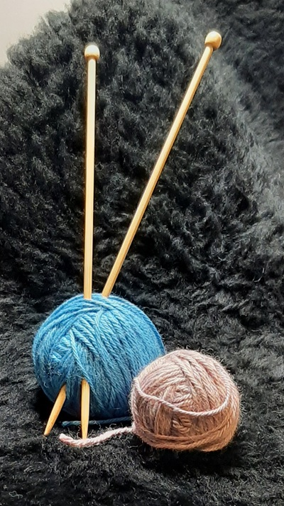
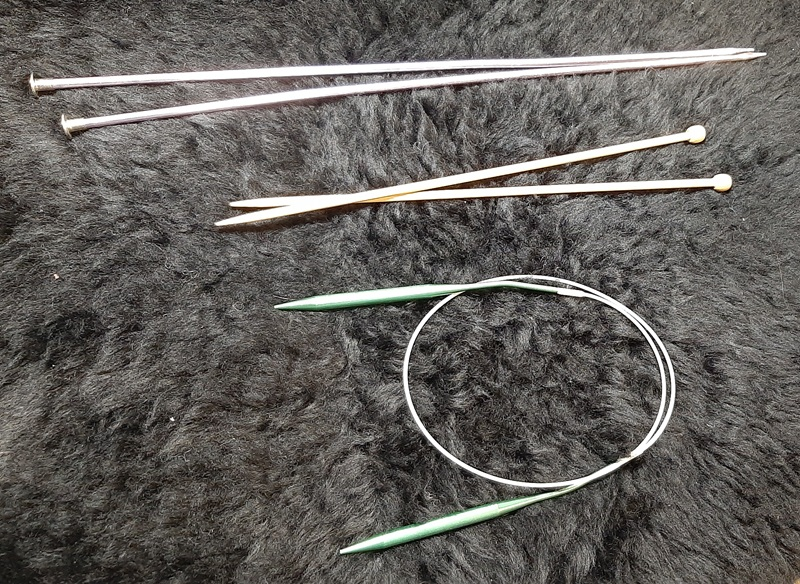
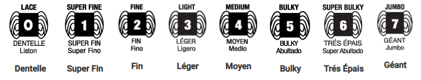
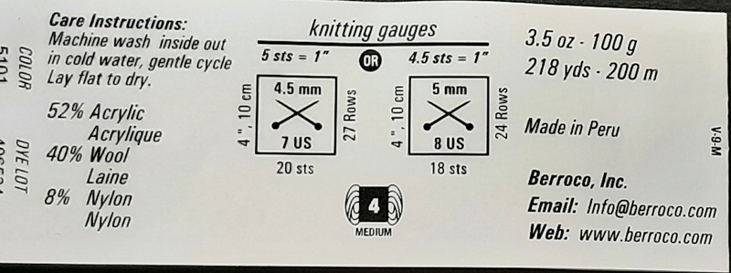

# Matériel

## Les essentiels pour débuter

<figure class="gauche">

<figcaption>
Deux pelotes de laine
</figcaption>
</figure>

Rien de surprenant, pour tricoter il vous faut des aiguilles à tricoter et au moins une pelote de laine.  Un ruban à mesurer (ou simplement une règle) vous sera aussi utile, de même qu'une paire de ciseaux et une aiguille pour rentrer les fils.

### Les aiguilles à tricoter

<figure class="droite">

<figcaption>
Différents types d'aiguilles à tricoter.
</figcaption>
</figure>

Les aiguilles peuvent être en plastique, en bois ou en métal. Quelle matière choisir ?  C'est une question de préférence personnelle !  Toutefois, la laine glisse plus sur le métal, alors que le bois est plus fragile.

Comme en cuisine, ou en construction, il existe deux systèmes de mesure de la grosseur des aiguilles à tricoter : le système métrique et le système « US ».  Les diamètres vont de 2,00 mm (US 0) à 25,00 mm (US 50).

Les aiguilles droites sont utilisées pour tricoter « à plat » : soit alterner les rangs endroit et les rangs envers.

Les aiguilles circulaires peuvent permettre de tricoter « en rond », mais elles peuvent aussi servir de la même façon que les aiguilles droites.

Finalement, les aiguilles à double pointe sont elles aussi utiles pour tricoter en rond, surtout de petits ouvrages, par exemple des chaussettes.

Les aiguilles se déclinent dans différentes longueurs.  Dans le cas des aiguilles circulaires, c'est surtout la longueur du câble entre les deux aiguilles qui varie.

### Le fil à tricoter

Fil plutôt que laine, car il n'y a pas que les toisons de moutons et apparentés qui peuvent se tricoter !  Il y a aussi la fibre de coton, de soie, d'acrylique, de nylon, de bambou... et différentes combinaisons de fibres.

L'organisme « Craft Yarn Council » a établi un système standard de la grosseur des fils par catégories : de 0 (dentelle) à 7 (géant).

<figure class="centre">

<figcaption>
Les catégories de fils
</figcaption>
</figure>

Les étiquettes donnent plusieurs informations clés sur le fil : sa composition, ses instructions d'entretien, sa catégorie, la longueur et le poids de l'écheveau, sa provenance, son lot de teinture.

<figure class="centre">

<figcaption>
Un exemple d'étiquette.
</figcaption>
</figure>

### Et pour se lancer ?

La laine ou un mélange de laine-acrylique sont de bons choix : ça glisse sans trop glisser sur les aiguilles et c'est plus agréable à manipuler que le fil 100 % acrylique. Ceci dit, l'acrylique est le choix le plus économique, et il peut tout à fait convenir !  

!!! tip "Astuce"

    Notez que les mailles sont généralement plus faciles à voir avec un fil de couleur claire.

Les mailles glissant moins sur des aiguilles en bois ou en bambou, c'est le meilleur choix pour débuter : vous risquerez moins de les « échapper ».  Des aiguilles en plastique peuvent aussi être un choix convenable - bien que clairement moins écologique.

Pour les grosseurs : moyenne pour les aiguilles (4,5 mm ou 5 mm - 7 ou 8 US) et moyenne pour le fil (catégorie 4).