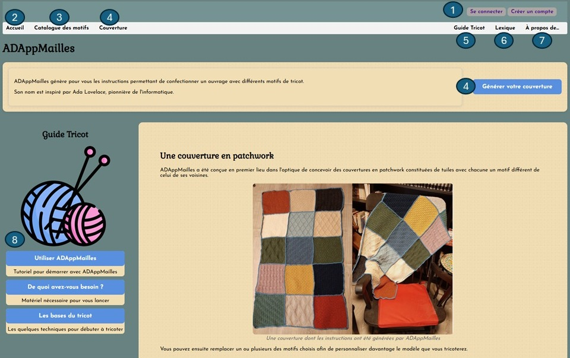
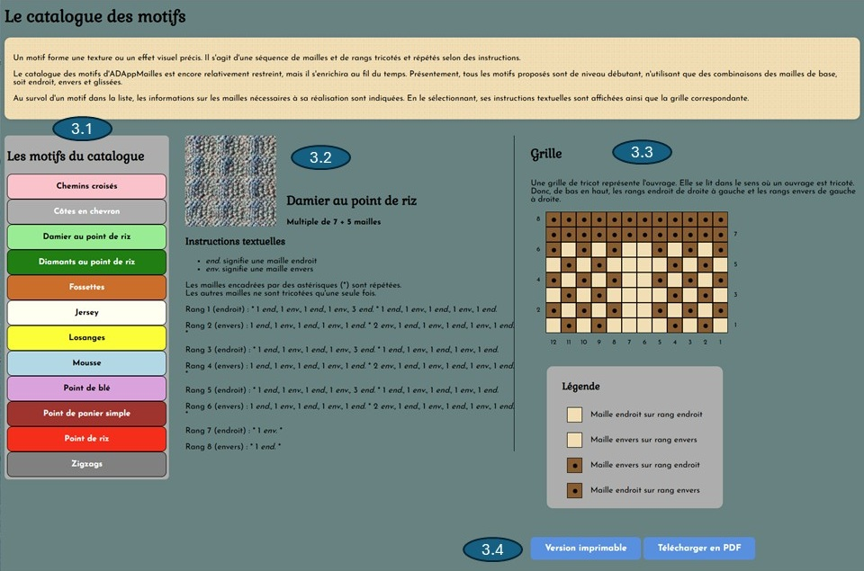
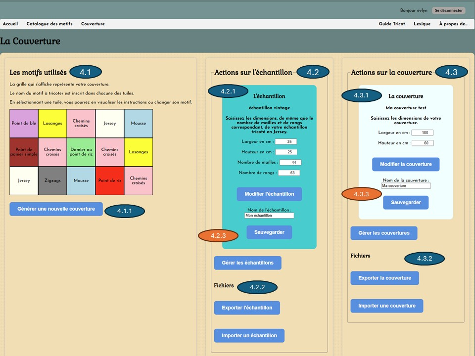
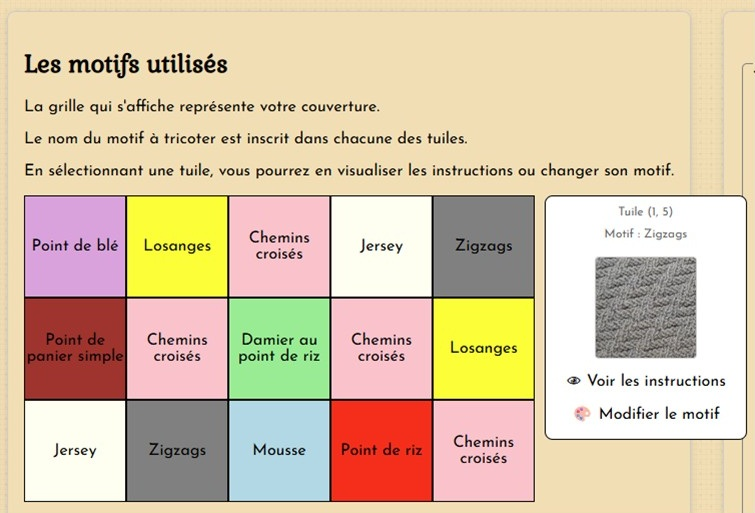
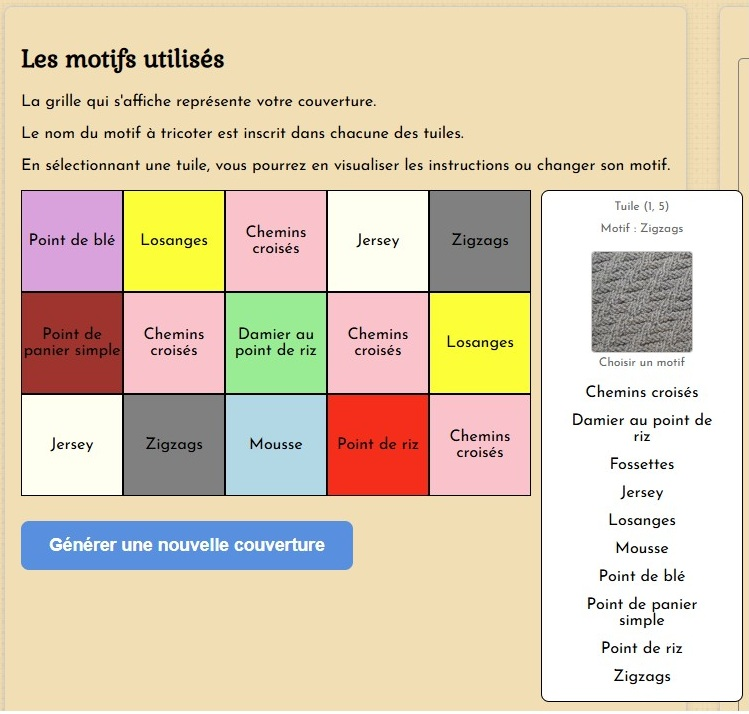
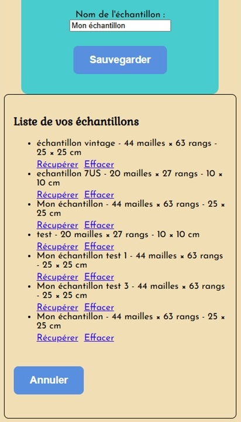
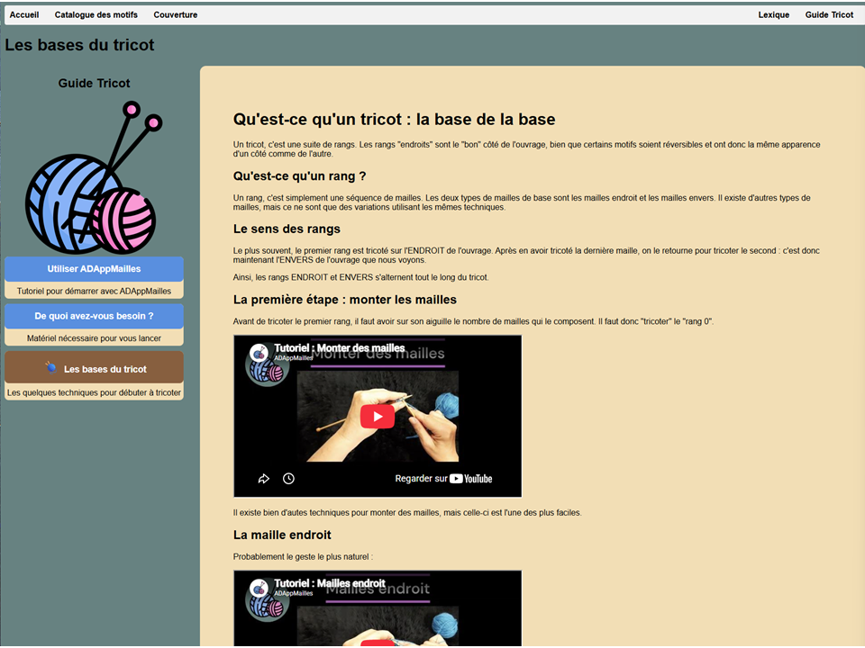

## À quoi sert ADAppMailles ?

À générer les instructions pour tricoter une couverture de style « patchwork » composée de carrés tricotés séparément et en utilisant différents motifs pour chacun d'eux.

### Pour créer votre première couverture rapidement :
   
1. Dans la section Couverture, l'application génère automatiquement les tuiles.
2. Vous pouvez changer les dimensions de la couverture, ou les paramètres de l'échantillon.
3. Cliquez sur une tuile pour en afficher les instructions ou pour changer le motif utilisé.
4. Imprimez les instructions pour tricoter chaque tuile !

## Naviguer dans l'application

<figure class="centre">

<figcaption>
Capture de l'écran d'accueil
</figcaption>
</figure>

- [1. Le menu de connexion](#1-le-menu-de-connexion)
- [2. Retour à la page d'accueil](#2-retour-a-la-page-daccueil)
- [3. Le Catalogue des motifs](#3-le-catalogue-des-motifs)
- [4. Générer une couverture](#4-generer-une-couverture)
- [5. Guide Tricot](#5-guide-tricot)
- [6. Lexique](#6-lexique)
- [7. À propos de...](#7-a-propos-de)
- [8. Menu du Guide](#8-menu-du-guide)
  
## 1. Le menu de connexion

Vous avez la possibilité de créer un compte d'usager sur ADAppMailles afin de sauvegarder et récupérer les paramètres de vos échantillons et de vos couvertures.

## 2. Retour à la page d'accueil

En tout temps, vous pouvez revenir à la page d'accueil.

## 3. Le Catalogue des motifs

Un motif est une texture, ou un effet visuel, obtenu par la combinaison et la séquence des mailles et des rangs tricotés.

Il existe une pléthore de motifs, certains très simples et d'autres nécessitant des techniques avancées.

<figure class="centre">

<figcaption>
Capture d'écran du catalogue
</figcaption>
</figure>

### 3.1 Sélectionner un motif

Pour le moment, ADAppMailles ne propose que des motifs de niveau débutant, obtenus en tricotant des mailles à l'endroit, à l'envers et des mailles glissées.

Au survol d'un élément de la liste des motifs disponibles, une boîte dont la couleur de fond est celle qui sera affichée dans la grille de la couverture apparaît.  Le nom du motif, de même que la structure de mailles qu'il requiert y sont indiqués.

En cliquant sur un élément, des informations supplémentaires s'affichent sur la page.

### 3.2 Les instructions textuelles

Outre une photo du rendu du motif, et à nouveau sa structure, les instructions pour le tricoter se trouvent au centre de l'écran.  Ces instructions utilisent les abréviations courantes dans les patrons. Puisqu'il n'existe pas de réel standard, du moins en français, leur signification est également indiquée.

### 3.3 La grille

À la droite de l'écran s'affichent les mêmes instructions, mais sous la forme d'une grille accompagnée de la légende des couleurs employées pour chacun des types de mailles en fonction du sens du rang.

Cette grille se lit selon les conventions usuelles du tricot, c'est-à-dire :

* Les rangs sont représentés de bas en haut.
* Les mailles des rangs endroit, de droite à gauche
* Les mailles des rangs envers, de gauche à droite

### 3.4 Imprimer un motif

Afin de permettre une impression rapide, une version en noir et blanc des instructions textuelles suivies par la grille s'ouvre dans une nouvelle fenêtre à l'utilisation du bouton « Version imprimable ».

Les instructions et la grille sont également disponibles au format .PDF.  Le nom du fichier téléchargé sera celui du motif.pdf, par exemple jersey.pdf

Dans les deux cas, pour la grille, ce sont les symboles standards qui sont utilisés plutôt qu'un code de couleur.  La légende est indiquée.

## 4. Générer une couverture

<figure class="centre">

<figcaption>
Capture de l'écran de la Couverture
</figcaption>
</figure>

ADAppMailles génère automatiquement une couverture dont le schéma des motifs s'affiche.  Seuls les motifs pouvant être adaptés aux dimensions de chaque tuile sont utilisés.  Pour certains, un ajustement aura été fait, en ajoutant des mailles de bordure. Chaque motif a une couleur de fond différente, la même que celle de la section du catalogue.

Les options indiquées dans les ovales orangés ne sont disponibles que si vous êtes connecté à votre compte ADAppMailles.

### 4.1 Les motifs utilisés

En cliquant sur l'une des tuiles, une photo du motif utilisé sera affichée, et deux options s'offriront :

<figure class="centre">

<figcaption>
Capture d'écran
</figcaption>
</figure>

####  Voir les instructions d'une tuile

Le haut de la page qui s'ouvre dans un nouvel onglet informe sur cette tuile : son motif, le nombre de mailles et de rangs, sa largeur et sa hauteur.

Suivent les instructions textuelles, avec les mêmes conventions que celles de la section du catalogue des motifs.

Ici aussi, le patron est proposé sous la forme d'une grille.

Le bouton « Version imprimable » ouvre une version en noir et blanc de cette page, et « Télécharger PDF » génère un fichier de ce format.

Finalement, le bouton « Fermer la fenêtre » évite de devoir remonter en haut de page.

####  Modifier le motif

La seconde option disponible est de changer le motif utilisé.  La liste déroulante ne présente que les motifs qui sont compatibles avec les dimensions de la tuile.  Notez que si le générateur automatique évite qu'un même motif se retrouve sur deux tuiles adjacentes, vous n'avez pas la même limitation.

<figure class="centre">

<figcaption>
Capture d'écran
</figcaption>
</figure>

#### 4.1.1 Générer une nouvelle couverture

ADAppMailles changera les motifs utilisés par les tuiles de la couverture.

### 4.2 Actions sur l'échantillon

#### 4.2.1 Les paramètres de l'échantillon

L'échantillon permet d'extrapoler les dimensions d'un tricot.  Chaque tricoteur et tricoteuse ayant sa propre tension. Chaque fil a sa propre épaisseur.  Et la grosseur des aiguilles utilisées a aussi son influence.

Les étiquettes des pelotes de fil indiquent le nombre de mailles et de rangs estimés afin d'obtenir un échantillon de 10 cm par 10 cm avec certaines grosseurs d'aiguilles, en point « Jersey ».  Vous pouvez donc, si vous utilisez la grosseur d'aiguille indiquée, saisir ces informations et débuter votre tricot.

<figure class="centre">

<figcaption>
Une étiquette
</figcaption>
</figure>

Toutefois, si vous voulez être plus précis, tricotez un échantillon et utilisez les données obtenues.  Vous pouvez fixer le nombre de mailles et de rangs, et mesurer la largeur et la hauteur obtenues.  Ou vous pouvez fixer les dimensions, et compter les mailles et les rangs.

Notez que vous devez saisir des nombres entiers pour chacun d'eux.

#### 4.2.2. Les fichiers

Il vous est possible, que vous soyez un usager connecté ou non, d'exporter les paramètres de votre échantillon : un fichier .json sera sauvegardé à l'emplacement de votre choix sur votre ordinateur en cliquant sur le bouton "Exporter l'échantillon".

Vous pourrez par la suite, en utilisant "Importer un échantillon", permettre à ADAppMailles de les récupérer.

#### 4.2.3. Sauvegarder et gérer les échantillons

<figure class="centre">

<figcaption>
Gestion des échantillons
</figcaption>
</figure>Si vous êtes connecté à un compte d'usager, vous pourrez sauvegarder les paramètres de vos échantillons dans l'application.

En utilisant "Gérer les échantillons" vous pourrez les récupérer ou les effacer de votre compte.

### 4.3 Actions sur la couverture

Pour le moment, ADAppMailles ne propose qu'une seule façon de générer une couverture.  À partir de sa largeur et de sa hauteur, l'application détermine le nombre de tuiles carrées à confectionner.  Ces tuiles seront les plus grandes possible.

Tout comme pour les échantillons, les options pour la modification des paramètres de la couverture, leur exportation ou leur importation, de même que leur sauvegarde et leur gestion sont proposées par ADAppMailles.

Notez que les paramètres de l'échantillon utilisé pour générer la couverture sont récupérés automatiquement.

## 5 Guide Tricot

L'objectif de cette section est de vous guider, d'abord dans l'utilisation d'ADAppMailles, avec le tutoriel que vous êtes en train de consulter, mais aussi dans l'univers du tricot en vous proposant&nbsp;:

* Une liste et des conseils pour choisir votre matériel, votre fil et vos aiguilles.

* Quelques notions théoriques, et des vidéos afin que vous puissiez vraiment voir les gestes&nbsp;!

<figure class="centre">

<figcaption>
Capture d'écran
</figcaption>
</figure>

## 6. Lexique

Cette section présente simplement toute la liste des abréviations utilisées dans les instructions textuelles, leurs significations, et un lien vers la vidéo YouTube qui la montre lorsque cette dernière est disponible.

## 7. À propos de...

Vous y trouverez une courte présentation de la personne derrière le code d'ADAppMailles. Une biographie très succincte d'Ada Lovelace qui a inspiré le nom de cette application. Et quelques liens pouvant être faits entre l'informatique et le tricot.

## 8. Menu du Guide Tricot

Un menu est dédié à cette section à gauche de l'écran, puisqu'elle s'enrichira au fil du temps.