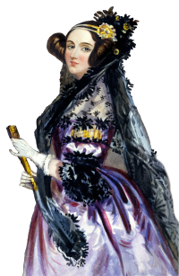

## Moi-même, la développeuse

Après une carrière de quelques décennies dans le domaine administratif, j'ai fait un retour aux études afin de me réorienter vers un secteur qui m'intéresse depuis toujours, et que j'avais exploré en dilettante (et sans trop de formalisme, je dois avouer !) depuis la fin de mon adolescence. Parce que, avant, les ordinateurs n'étaient pas vraiment disponibles pour le grand public - ce qui trahit un peu mon âge.

Pour le projet de fin de Majeure en informatique de la TÉLUQ, pourquoi ne pas combiner avec l'un de mes loisirs préférés ? Une activité manuelle qui m'a permis de ménager un peu mes neurones et de relaxer après les heures d'études, de recherche des erreurs et des « Pourquoi ça ne fait pas ce que je pensais que ca allait faire ? ».

C'est donc de cette conjoncture qu'est venue l'idée d'ADAppMailles.

Merci à monsieur Christian Jauvin d'avoir accepté de me superviser, à celles et ceux qui ont testé l'application à différents moments, à ma famille et surtout à Serge, pour son support passé, présent et futur.

<figure class="gauche">

<figcaption>
Portrait d'Ada Lovelace*
</figcaption>
</figure>

## Ada Lovelace (10 décembre 1815 – 27 novembre 1852)

Fille légitime du poète Lord Byron, elle est considérée aujourd'hui comme celle qui a écrit la première boucle conditionnelle et le premier programme informatique.

Son algorithme calculait les nombres de Bernoulli, et il devait « rouler » non pas sur un Mac, un PC ou une tablette, mais sur la machine analytique de Charles Babbage.  

Si elle avait été construite dans son entièreté, cette machine analytique, un genre de calculatrice mécanique programmable, aurait occupé une pièce entière.  Elle est considérée comme l'ancêtre des ordinateurs.  

Nous sommes en 1842.

(Source : Wikipédia, https://fr.wikipedia.org/wiki/Ada_Lovelace, consulté le 10 septembre 2026)

## Informatique et tricot

Plusieurs liens peuvent être faits entre l'informatique et le tricot.  Les ordinateurs, à la base, ne comprennent que les 0 et 1.  Les ouvrages tricotés ont un endroit et un envers.  Les types de maille fondamentaux sont aussi binaires : endroit et envers.  Toutefois, comme pour les bits des ordinateurs, ils peuvent se combiner pour former des structures et des motifs bien plus complexes!

D'ailleurs, les grilles de tricot peuvent se programmer pour être exécutées sur des machines mécaniques.  Au début du XIXe siècle, le métier à tisser Jacquard utilise des cartes perforées.  C'est aussi le cas de la machine analytique de Babbage (qui s'en est directement inspiré en fait). Elles seront aussi un support courant pour les programmeurs informatiques, des années 1950 jusqu'au milieu des années 1970.

Les programmes de l'Apollo Guidance Computer, développés au MIT et embarqués à bord des missions Apollo vers la Lune, étaient en quelque sorte physiquement « tricotés ». Ils étaient encodés dans une mémoire permanente (core rope memory) par des fils qui passaient - ou ne passaient pas - dans des noyaux magnétiques.  Anecdote intéressante : ce sont principalement des femmes ayant de l'expérience dans l'industrie textile qui ont fabriqué ces modules, selon le patron correspondant au programme à encoder. (Source : https://news.mit.edu/2019/behind-scenes-apollo-mission-0718, consulté le 11 septembre 2026)

Nous pouvons donc suivre le fil, de la laine des moutons que nous comptons pour nous endormir jusqu'à la mémoire tissée qui a permis de faire « un petit pas pour l'homme, un bond de géant pour l'humanité » (Neil Armstrong, le 21 juillet 1969) !

*Source de l'image : https://openclipart.org/detail/237398/ada-king-countess-of-lovelace-portrait
